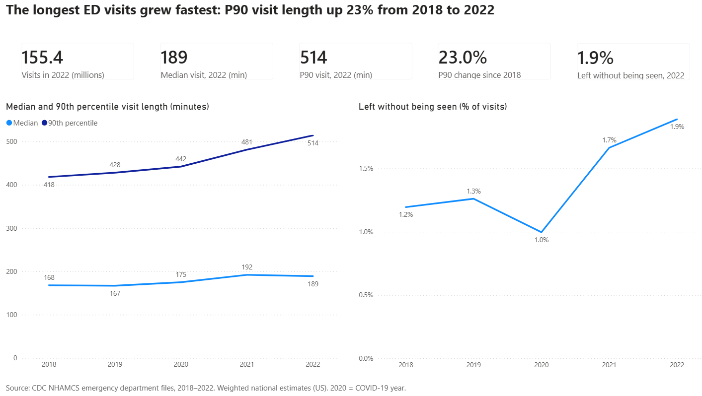
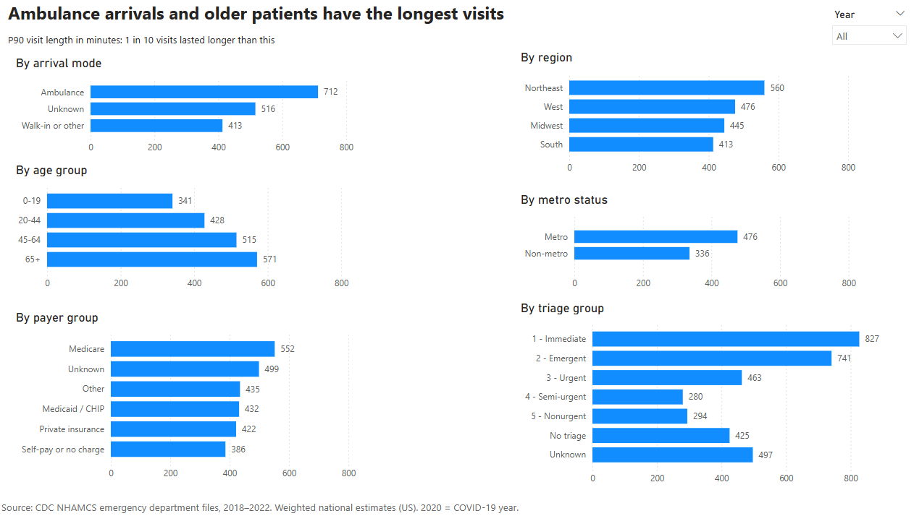
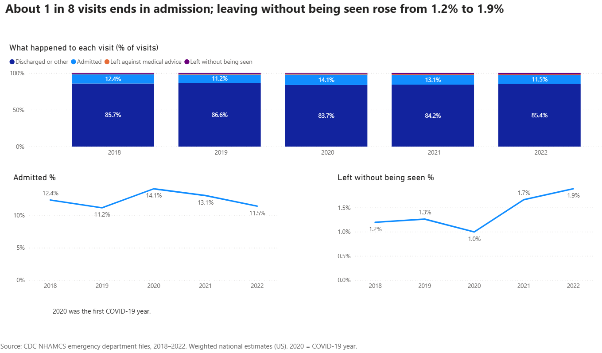
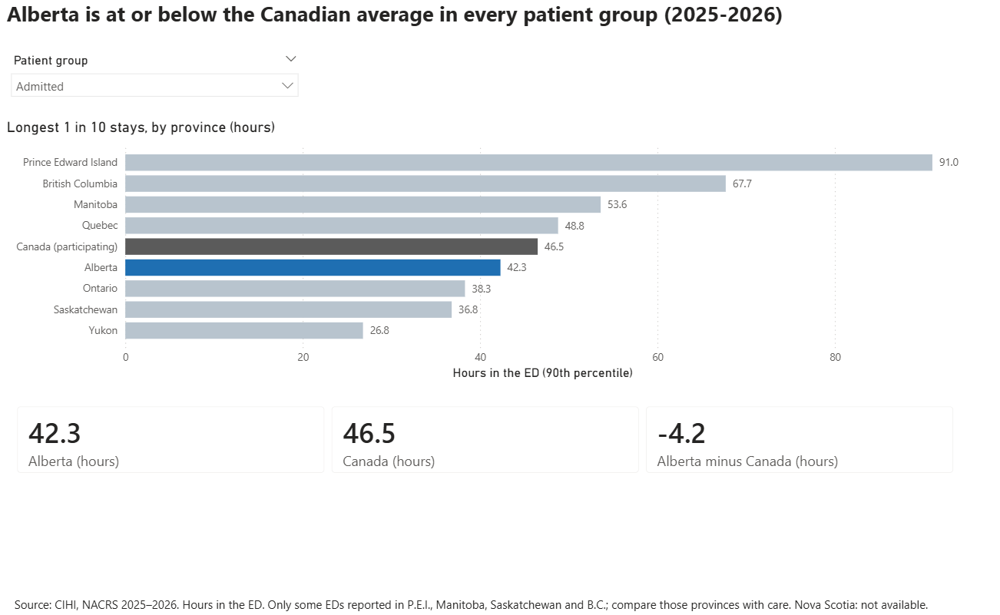
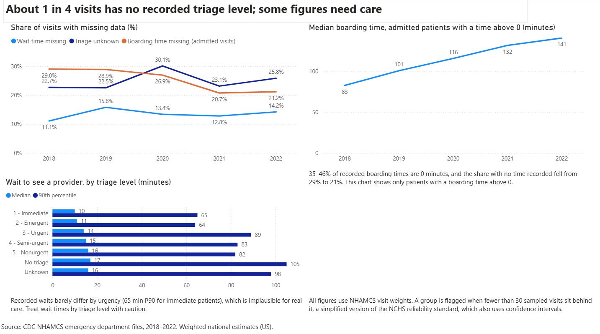
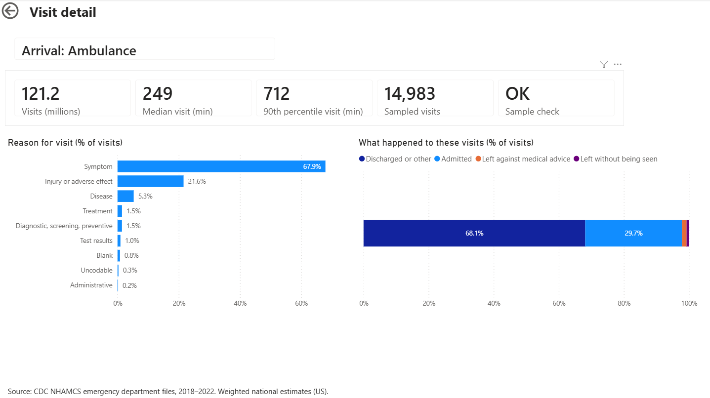
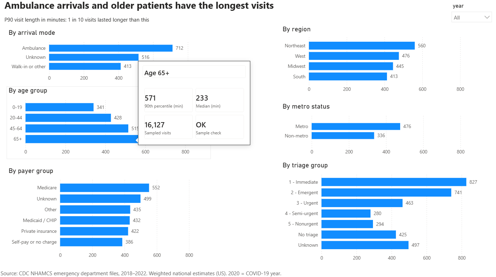

# Emergency Department Performance: US Visit-Level Analysis with an Alberta Benchmark

A Power BI report on how long patients spend in emergency departments, built from **86,864 sampled US emergency department visits** (CDC NHAMCS, 2018–2022) that represent **707 million visits** nationally. A separate page compares Alberta with other provinces using CIHI's 2025–2026 emergency department tables.

The pipeline goes from raw survey files to a tested PostgreSQL star schema to a Power BI model with weighted DAX measures. Every figure in the report is checked against values computed independently in Python and SQL.

**Tools:** Python (pandas, SQLAlchemy) · PostgreSQL · SQL · Power BI · DAX · Git



## Key findings

1. **The longest visits grew fastest.** From 2018 to 2022 the 90th percentile (P90) visit length rose from 418 to 514 minutes (+23.0%), while the median rose from 168 to 189 minutes (+12.5%). The slowest 1 in 10 visits got longer about twice as fast as the typical visit.
2. **Ambulance arrivals and older patients stay longest.** P90 visit length (all years): ambulance 712 minutes vs walk-in 413; age 65+ 571 vs age 0–19 341; triage level 1 (Immediate) 827.
3. **Leaving without being seen rose from 1.2% to 1.9%** of visits between 2018 and 2022. About 1 in 8 visits ended in admission (12.4% across all years).
4. **Some fields can't support firm conclusions.** Triage level is unknown for 22.5–30.1% of visits each year, and recorded waits barely differ by urgency (65-minute P90 for Immediate patients), so wait time by triage level is shown only on the Data quality page, with a caveat.
5. **Alberta is at or below the Canadian average in every patient group** (CIHI, 2025–2026). For admitted patients, the longest 1 in 10 stays was 42.3 hours in Alberta vs 46.5 hours across participating provinces.

## Why US data for an Alberta project?

Visit-level emergency department data for Alberta isn't publicly available; CIHI publishes only summary tables by province. NHAMCS is a public, visit-level national survey, so it supports the analysis a summary table can't: percentiles by group, drill-through and data-quality checks. The Alberta page uses CIHI data only. The two sources differ in country, years, units and patient groups, so they are never combined or compared directly.

## Report pages

| Page | What it shows |
| --- | --- |
| Overview | 2022 headline numbers; median and P90 visit length by year; left without being seen by year |
| Who stays longest | P90 visit length by arrival mode, age, payer, region, metro status and triage level, with a year slicer |
| Patient flow | Outcome of every visit by year (discharged, admitted, left against medical advice, left without being seen) |
| Alberta vs provinces | CIHI 2025–2026: P90 hours in the ED by province, for three patient groups |
| Data quality | Missing data over time, wait by triage level, boarding time, and the method note |
| Visit detail (drill-through) | Right-click any bar on *Who stays longest* to see that group's numbers, reasons for visit and outcomes |
| Bar tooltip | Hover over any bar on *Who stays longest* for the group's P90, median, sample size and sample check |

A PDF of the main pages is in [`docs/alberta-ed-performance.pdf`](docs/alberta-ed-performance.pdf).

<details>
<summary>Screenshots of every page</summary>








</details>

## How it was built

```
CDC Stata files ──> extract.py ──> clean.py ──> load.py ──> PostgreSQL ──> transform.py (star schema) ──> checks.py ──> Power BI
CIHI Excel table ──> load_cihi.py ──────────────────────────> PostgreSQL ─────────────────────────────────────────────┘
```

| Step | File | What it does |
| --- | --- | --- |
| Extract | `src/extract.py` | Reads the five NHAMCS Stata files (codes kept, labels saved as lookup tables) and stacks them into one table of 86,864 visits |
| Clean | `src/clean.py` | Converts times to minutes, keeps a reason for every missing value (blank, unknown, not applicable), groups triage, outcome, age and arrival |
| Load | `src/load.py` | Loads the cleaned visits and lookups into PostgreSQL and verifies counts and weights against the CSV |
| Model | `sql/01_dimensions.sql`, `sql/02_fact.sql`, `sql/03_views.sql` via `src/transform.py` | Builds a star schema: `fact_ed_visit` plus 12 dimension tables with foreign keys, and two summary views |
| Test | `src/checks.py` | 12 data-quality checks; results in [`docs/data_quality_report.md`](docs/data_quality_report.md) (11 pass, 1 warning) |
| Benchmark | `src/load_cihi.py` | Loads CIHI Table 1 and checks that the provinces add up to CIHI's Canada total |
| Report | `dashboards/alberta-ed-performance.pbix` | Power BI model and seven report pages |

### Checks worth noting

- **Weighted totals match CDC's published estimates** for every year (for example, 155.4 million visits in 2022 vs CDC's 155 million).
- **Python, SQL and DAX agree.** Weighted medians from the SQL views match Python's for every year, and every Power BI page was checked against the expected values in [`docs/dax_measures.md`](docs/dax_measures.md).

## DAX highlights

All 28 measures are documented with expected values in [`docs/dax_measures.md`](docs/dax_measures.md).

- **Weighted percentiles by hand.** NHAMCS is a weighted survey: each sampled visit stands for thousands of real visits. DAX's built-in `MEDIAN` and `PERCENTILE.INC` ignore weights, so the median and P90 measures build a running total of weights over each distinct minute value and return the first minute that reaches 50% or 90%. This is the same rule as the SQL views and the Python code, so all three give identical results.
- **Rates that stay correct under filters.** Rate denominators remove the outcome filter, so a slicer can't push a rate above 100%.
- **Year comparisons without a date table.** The data has survey years only, so change-over-time measures use the year column directly instead of time-intelligence functions.
- **Small-sample screen.** `Sample Visits` counts the sampled records behind each figure, and `Low Sample Flag` greys out any bar with fewer than 30. No group on the *Who stays longest* page falls below 30, even for a single year (smallest: 330 sampled visits).
- **Drill-through and tooltip pages** reuse one `Selected Group` measure that names the group being viewed (for example, "Arrival: Ambulance").

## Limitations

- **Simplified reliability rule.** NCHS reliability standards use design-based confidence intervals. This project uses a simpler screen of at least 30 sampled visits and doesn't compute confidence intervals.
- **Recorded times.** Times come from hospital records. Wait times show little difference by triage level, and 35–46% of recorded boarding times are exactly 0 minutes, so the report shows median boarding only for patients with a boarding time above 0.
- **2020 was the first COVID-19 year.** Visit volumes and patterns that year may not reflect normal operations.
- **US and Canadian figures aren't comparable.** The CIHI page uses hours in the ED for 2025–2026 and covers only participating provinces; some provinces reported only some EDs.
- **No public Power BI link.** Publish to web requires a work or school account, so the report is shared here as the `.pbix` file, a PDF and screenshots.

## Run it yourself

1. Download the NHAMCS emergency department public-use Stata files for 2018–2022 from [CDC's Ambulatory Health Care Data page](https://www.cdc.gov/nchs/ahcd/) into `data/raw/nhamcs/`, and CIHI's 2025–2026 emergency department data tables from [CIHI](https://www.cihi.ca/) into `data/raw/cihi/`.
2. Install PostgreSQL, create a database named `alberta_ed`, and copy `.env.example` to `.env` with your database password.
3. Install packages: `pip install -r requirements.txt`
4. Run, in order, from the `src` folder: `extract.py`, `clean.py`, `load.py`, `transform.py`, `checks.py`, `load_cihi.py`. Each script prints PASS or FAIL.
5. Open `dashboards/alberta-ed-performance.pbix` in Power BI Desktop. To refresh, point the PostgreSQL source at your own database.

## Data sources

- Centers for Disease Control and Prevention, National Center for Health Statistics. *National Hospital Ambulatory Medical Care Survey (NHAMCS), Emergency Department public-use data files, 2018–2022.*
- Canadian Institute for Health Information. *NACRS Emergency Department Visits and Lengths of Stay by Province/Territory, 2025–2026.*

Raw data files aren't stored in this repository; download them from the sources above.

## License

MIT. See [LICENSE](LICENSE).
